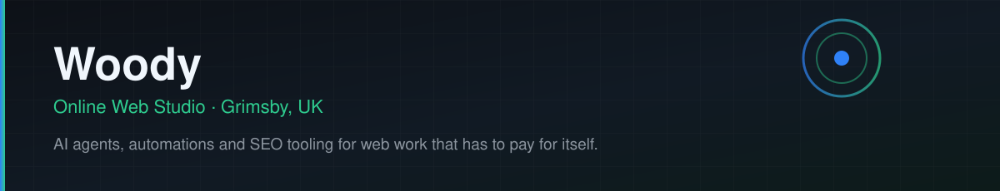

<div align="center">




</div>

# Hi, I'm Woody 👋

I run **[Online Web Studio](https://onlinewebstudio.co.uk/)**, a web and digital marketing studio in Grimsby, UK. I build the tooling behind it — AI agents, WordPress automations and data pipelines that take the manual work out of SEO, reporting and lead generation.

Everything here is mine, not a client's. I build a working version first, then refine it — most of it in Python, most of it on a cron.

## `> whoami`

```python
woody = {
    "name":  "Paul 'Woody' Wood",
    "role":  "Founder, Online Web Studio",
    "based": "Grimsby, UK",
    "team":  "Solo operator — the staff are agents",
    "motto": "Ship a working version first, then refine it",
    "focus": "AI agents that do the work, not just talk about it",
    "rules": "Nothing client-owned in this account, ever",
}
```

## 🔭 What I'm working on

- **AI agents & automations** — long-running agents that watch sources, extract the signal and report back, unattended
- **SEO & local search** — WordPress and Elementor builds, Google Business Profile, technical SEO, DNS and hosting
- **Data pipelines on official APIs** — price tracking, market and competitor monitoring, no scraping and no proxy games
- **AI-assisted delivery** — using LLM tooling across audit → plan → build → report, without shipping the same job twice

## 🛠️ Tech I work with

**Languages & markup**


**Web & SEO**


**All the other stuff**


## 📦 Things worth a look

- **[yt-education-agent](https://github.com/onlinewebst-ship-it/yt-education-agent)** — 24/7 agent watching educational YouTube channels and turning them into a living knowledge document: concepts, skills, tools and a changelog. Runs with no API key.
- **[-Travel-Price-Tracker](https://github.com/onlinewebst-ship-it/-Travel-Price-Tracker)** — flight and hotel price tracking over time on official travel APIs. No scraping, no proxies, GBP by default.
- **[hermes-template](https://github.com/onlinewebst-ship-it/hermes-template)** — starter template for Hermes agent projects. [Live demo](https://hermes-template.vercel.app)

## 📫 Get in touch

- 🌐 **[onlinewebstudio.co.uk](https://onlinewebstudio.co.uk/)**
- 👔 **[LinkedIn — in/woodypaul](https://www.linkedin.com/in/woodypaul/)**
- ✉️ **[online.webst@gmail.com](mailto:online.webst@gmail.com)**

<sub>Client work stays with my clients — nothing in this account is a client's codebase or data.</sub>
